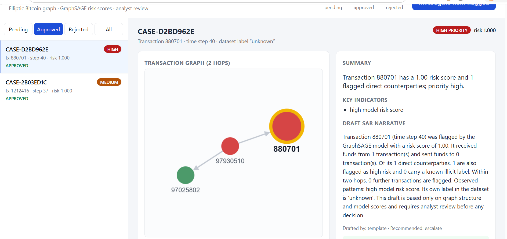
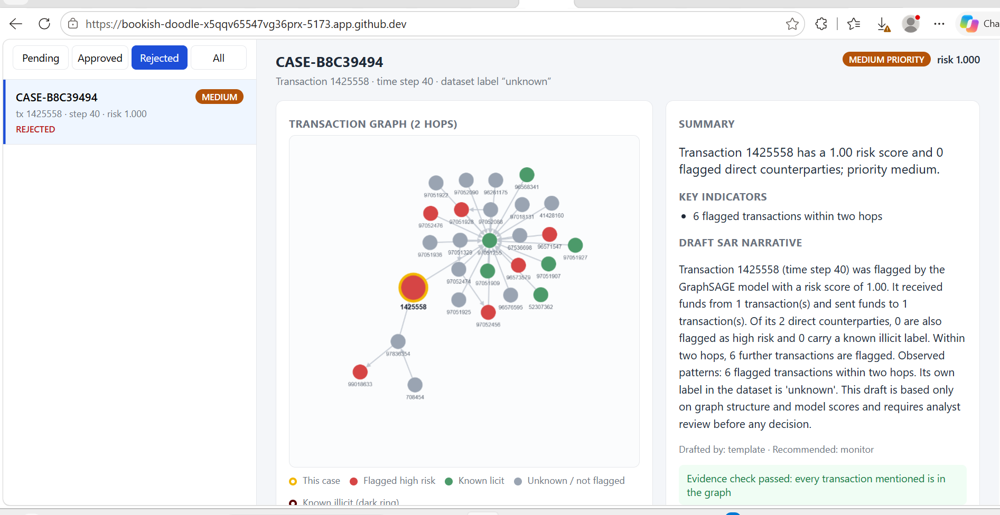
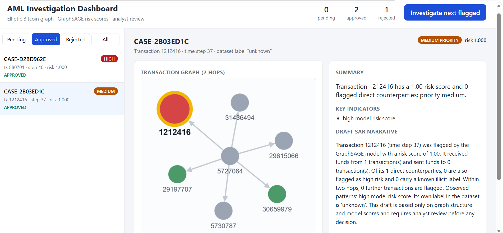
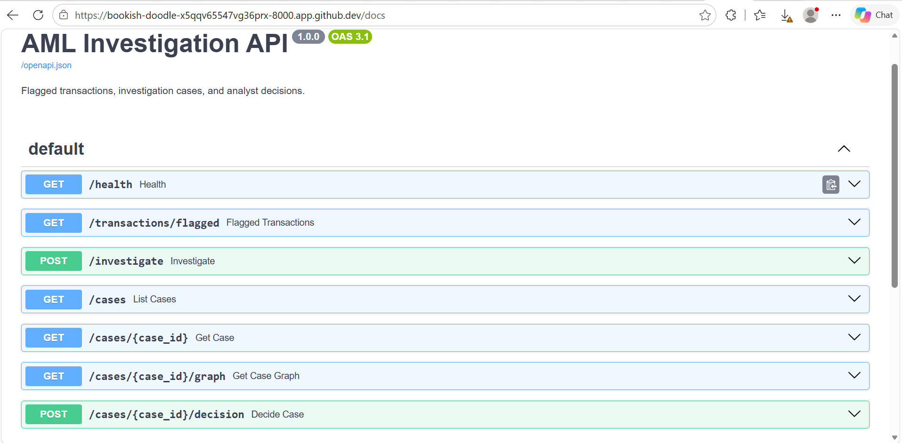

# Graph-Based AML Investigation Workflow

An end-to-end **anti-money laundering (AML)** system that turns raw Bitcoin transactions into a transaction graph, flags likely illicit activity with a **Graph Neural Network (GraphSAGE)**, and supports analysts with an **LLM-powered investigation workflow** that drafts SAR-style narratives, with **human-in-the-loop review** before any case is closed.




---

## Table of Contents
- [Overview](#overview)
- [Demo](#demo)
- [Project Status](#project-status)
- [Architecture](#architecture)
- [Dataset](#dataset)
- [Features](#features)
- [Tech Stack](#tech-stack)
- [Project Structure](#project-structure)
- [Quick Start (Google Colab)](#quick-start-google-colab)
- [Getting Started](#getting-started)
- [Usage](#usage)
- [Model Results](#model-results)
- [Investigation Workflow](#investigation-workflow)
- [Limitations](#limitations)
- [Future Work](#future-work)
- [Acknowledgements](#acknowledgements)
- [License](#license)

---

## Overview

Traditional rule-based AML systems look at transactions one at a time and miss patterns that only appear across **connected** transactions (layering, fan-in / fan-out, peel chains). This project treats transactions as a **graph** and combines three things:

1. **Data pipeline** – PySpark processes ~200K Bitcoin transactions from the public Elliptic dataset and builds a transaction graph.
2. **Graph ML** – A GraphSAGE model learns from each transaction's features *and* its neighbours to flag likely illicit transactions, benchmarked against an XGBoost baseline.
3. **Investigation workflow** – A LangGraph agent pulls the suspicious subgraph, scores risk, and drafts a SAR-style narrative. An analyst reviews it in a React dashboard and approves or rejects the case.

> ⚠️ This is a research / portfolio project built on a public dataset. It is not a production compliance system and its outputs are not legal or regulatory findings.

---

## Demo

The screenshots below are from an end-to-end run: GraphSAGE scored the test period (time steps 35–49), the risk scores were loaded into Neo4j, the LangGraph workflow drafted three cases, and an analyst reviewed them in the dashboard.

| Stage | Result |
|-------|--------|
| Transactions loaded into Neo4j | 67,504 |
| Payment flows loaded | 77,512 |
| Flagged as high risk by GraphSAGE | 5,431 |
| Cases drafted by the workflow | 3 (1 high, 2 medium priority) |
| Analyst decisions | 2 approved, 1 rejected |

**Rejected case: when the human overrides the model.** Transaction 1425558 had a near-maximum risk score, but neither of its direct counterparties was flagged. Most of the six flagged transactions within two hops connect through a busy, known-licit hub, so the analyst rejected it as a false positive.



**Approved case: fan-out source.** Transaction 1212416 received funds from a transaction that fans out to six others.



**API.** Interactive documentation is generated by FastAPI at `/docs`.



---

## Project Status

| Component | Status |
|-----------|--------|
| PySpark graph pipeline (`pipeline/`) | ✅ Done |
| XGBoost baseline + GraphSAGE model (`models/`) | ✅ Done |
| Neo4j graph loader (`graph_db/`) | ✅ Done |
| LangGraph investigation workflow (`agent/`) | ✅ Done |
| FastAPI backend + tests (`api/`, `tests/`) | ✅ Done |
| React + Cytoscape.js dashboard (`frontend/`) | ✅ Done |

---

## Architecture

```
            ┌──────────────────────┐
            │  Elliptic Dataset    │  (features, edges, labels)
            └──────────┬───────────┘
                       │
            ┌──────────▼───────────┐
            │  PySpark Pipeline    │  clean → join → build graph
            └──────────┬───────────┘
                       │
        ┌──────────────┼────────────────┐
        │                               │
┌───────▼─────────┐            ┌────────▼────────┐
│  GraphSAGE      │            │     Neo4j       │
│ (PyTorch Geo)   │──scores──▶ │ Transaction     │
│ vs XGBoost      │            │ Graph + Risk    │
└─────────────────┘            └────────┬────────┘
                                        │
                              ┌─────────▼──────────┐
                              │ LangGraph Workflow │
                              │ retrieve → score → │
                              │ summarize → review │
                              └─────────┬──────────┘
                                        │
                              ┌─────────▼──────────┐
                              │   FastAPI Backend  │
                              └─────────┬──────────┘
                                        │
                              ┌─────────▼──────────┐
                              │ React + TypeScript │
                              │ Cytoscape.js UI    │
                              │ (Analyst Review)   │
                              └────────────────────┘
```

---

## Dataset

**Elliptic Bitcoin Dataset** (public)

| Item | Details |
|------|---------|
| Nodes | ~200K Bitcoin transactions |
| Edges | ~234K payment flows between transactions |
| Features | 166 per transaction (local + aggregated neighbourhood features) |
| Time steps | 49 |
| Labels | Illicit, Licit, Unknown (most nodes are unlabeled) |

The easiest way to get it is through PyTorch Geometric, which downloads the original CSV files:

```python
from torch_geometric.datasets import EllipticBitcoinDataset
EllipticBitcoinDataset(root="data/elliptic")
```

Then copy the CSVs to `data/raw/`:

```bash
mkdir -p data/raw
cp data/elliptic/raw/*.csv data/raw/
```

You can also download it from [Kaggle](https://www.kaggle.com/datasets/ellipticco/elliptic-data-set). Either way, `data/raw/` should contain:

```
data/raw/elliptic_txs_features.csv
data/raw/elliptic_txs_edgelist.csv
data/raw/elliptic_txs_classes.csv
```

> The dataset is not included in this repo. Please follow its license terms.

---

## Features

- **Scalable data processing** with PySpark – cleaning, label mapping, and graph construction.
- **Graph Neural Network** (GraphSAGE) that uses neighbourhood patterns, not just single-transaction features.
- **Baseline comparison** against XGBoost using precision, recall, and F1 on the illicit class.
- **Temporal train/validation/test split** by time step to avoid data leakage.
- **Class imbalance handling** with class weights, and a decision threshold tuned on validation data.
- **Early stopping** on validation PR-AUC for both models.
- **Neo4j graph store** for fast multi-hop transaction tracing.
- **LangGraph investigation agent**: graph retrieval → risk scoring → LLM summary → SAR-style narrative draft.
- **Human-in-the-loop**: no case is closed without analyst approval or rejection.
- **Interactive dashboard** with Cytoscape.js for graph visualization, transaction tracing, and case review.

---

## Tech Stack

| Layer | Tools |
|-------|-------|
| Data Processing | Python, PySpark, Pandas |
| Graph ML | PyTorch, PyTorch Geometric (GraphSAGE) |
| Baseline | XGBoost, Scikit-learn |
| Graph Database | Neo4j (Cypher) |
| Agent Workflow | LangGraph, LLM API |
| Backend | FastAPI |
| Frontend | React, TypeScript, Cytoscape.js |

---

## Project Structure

```
Graph-Based-AML-Investigation-Workflow/
├── data/
│   ├── raw/                  # Elliptic CSVs (not committed)
│   └── processed/            # nodes, edges, risk scores (Parquet, not committed)
├── pipeline/
│   └── build_graph.py        # PySpark: clean data, build edges/nodes
├── models/
│   ├── data.py               # Shared loading, temporal split, metrics
│   ├── graphsage.py          # GraphSAGE model definition
│   ├── train_gnn.py          # GNN training, evaluation, risk scores
│   ├── train_xgboost.py      # XGBoost baseline
│   └── results/              # Test metrics as JSON
├── graph_db/
│   └── load_neo4j.py         # Load nodes, edges, risk scores into Neo4j
├── agent/
│   ├── workflow.py           # LangGraph: retrieve → score → draft → validate → save
│   ├── tools.py              # Neo4j queries (neighbourhood, cases, decisions)
│   ├── llm.py                # Narrative drafting: template, Claude, or Gemini
│   └── prompts.py            # SAR narrative prompt
├── api/
│   └── main.py               # FastAPI endpoints
├── tests/
│   └── test_api.py           # pytest API tests (no database needed)
├── frontend/                 # React + TypeScript + Cytoscape.js dashboard
│   └── src/
│       ├── App.tsx
│       ├── api.ts
│       └── components/       # CaseList, CaseDetailView, GraphView, DecisionPanel
├── requirements.txt
├── .env.example
└── README.md
```

---

## Quick Start (Google Colab)

The pipeline and models run in a free [Google Colab](https://colab.research.google.com) notebook with no local setup. Run each block as its own cell:

```python
!git clone https://github.com/likitha-reddy-ux/Graph-Based-AML-Investigation-Workflow.git
%cd Graph-Based-AML-Investigation-Workflow
!pip install -q pyspark xgboost torch_geometric
```

```python
from torch_geometric.datasets import EllipticBitcoinDataset
EllipticBitcoinDataset(root="data/elliptic")
```

```python
!mkdir -p data/raw && cp data/elliptic/raw/*.csv data/raw/
!python pipeline/build_graph.py
!python models/train_xgboost.py
!python models/train_gnn.py
```

For faster GraphSAGE training, switch to a GPU first: **Runtime → Change runtime type → T4 GPU**.

---

## Getting Started

### Prerequisites
- Python 3.10+
- Java 11 or 17 (for PySpark)
- Node.js 18+
- A Neo4j database (free [Neo4j Aura](https://console.neo4j.io) instance or local Docker)
- Optional: an Anthropic or Gemini API key (narratives use a free rule-based template by default)

### 1. Clone the repo
```bash
git clone https://github.com/likitha-reddy-ux/Graph-Based-AML-Investigation-Workflow.git
cd Graph-Based-AML-Investigation-Workflow
```

### 2. Set up Python environment
```bash
python -m venv venv
source venv/bin/activate        # Windows: venv\Scripts\activate
pip install -r requirements.txt
```

### 3. Configure environment variables
```bash
cp .env.example .env
```
Fill in `.env`:
```
NEO4J_URI=bolt://localhost:7687
NEO4J_USER=neo4j
NEO4J_PASSWORD=your_password
LLM_API_KEY=your_api_key
```

### 4. Start Neo4j (Docker option)
```bash
docker run -d --name neo4j -p 7474:7474 -p 7687:7687 \
  -e NEO4J_AUTH=neo4j/your_password neo4j:5
```

### 5. Install frontend dependencies
```bash
cd frontend
npm install
```

---

## Usage

```bash
# 1. Build the transaction graph
python pipeline/build_graph.py

# 2. Train models
python models/train_xgboost.py
python models/train_gnn.py

# 3. Load graph + risk scores into Neo4j (test period by default)
python graph_db/load_neo4j.py

# 4. Investigate the riskiest flagged transactions (creates pending-review cases)
python agent/workflow.py --top 3

# 5. Run the API tests
pytest tests/ -v

# 6. Start the API (docs at http://localhost:8000/docs)
uvicorn api.main:app --reload

# 7. Start the dashboard (new terminal)
cd frontend && npm install && npm run dev
```

Open the dashboard at `http://localhost:5173`. The dashboard forwards `/api` requests to the FastAPI server on port 8000.

### API endpoints

| Method | Endpoint | Purpose |
|--------|----------|---------|
| GET | `/health` | API and Neo4j status |
| GET | `/transactions/flagged` | Highest-risk flagged transactions |
| POST | `/investigate` | Run the LangGraph workflow and create cases |
| GET | `/cases` | List cases, filter by `status` |
| GET | `/cases/{case_id}` | Case details and draft narrative |
| GET | `/cases/{case_id}/graph` | 2-hop transaction graph in Cytoscape.js format |
| POST | `/cases/{case_id}/decision` | Analyst approves or rejects (only once per case) |

---

## Model Results

Both models use the same **temporal split**, so they are tested on transactions from later time periods than they were trained on:

| Split | Time steps | Used for |
|-------|-----------|----------|
| Train | 1–29 | Learning model weights |
| Validation | 30–34 | Early stopping and choosing the decision threshold |
| Test | 35–49 | Final reported results |

Scores are for the **illicit class** on the test set. Only labeled transactions are scored; unlabeled ones still act as neighbours in the graph.

| Model | Precision | Recall | F1 | PR-AUC |
|-------|-----------|--------|----|--------|
| XGBoost (baseline) | 0.568 | **0.741** | **0.643** | **0.771** |
| GraphSAGE | **0.587** | 0.586 | 0.587 | 0.560 |

Test set: 16,670 labeled transactions, of which 1,083 are illicit. Full results, including the chosen thresholds, are in [`models/results/`](models/results/).

**Key findings**

- **XGBoost outperformed GraphSAGE** on F1 (0.643 vs. 0.587) and especially on PR-AUC (0.771 vs. 0.560), catching about 74% of illicit transactions compared with about 59%.
- **GraphSAGE was slightly more precise** (0.587 vs. 0.568), meaning a little fewer false alarms among the transactions it flagged.
- A likely reason for the gap: 72 of the 165 Elliptic features are already **aggregated from each transaction's neighbours**, so a strong tree model gets much of the graph signal without message passing. This matches results reported in the original Elliptic paper (Weber et al., 2019), where tree ensembles beat GCNs on node features.
- Both models face the **dark-market shutdown** around time step 43, after which illicit patterns change and every model trained on earlier data struggles.

**Note:** The Elliptic dataset is highly imbalanced (about 6.5% of the labeled test transactions are illicit), so PR-AUC and illicit-class F1 are more meaningful here than accuracy.

---

## Investigation Workflow

The LangGraph agent runs these steps for each flagged transaction:

1. **Retrieve** – Query Neo4j for the transaction, its senders and receivers, and transactions two hops away.
2. **Score** – Compute explainable signals (fan-in, fan-out, links to known illicit or flagged transactions) and a case priority.
3. **Draft** – Write a SAR-style summary, indicators, recommended action, and narrative. Uses a rule-based template by default, or Claude / Gemini when an API key is set; LLM output is validated against a Pydantic schema.
4. **Validate** – Check that every transaction ID in the draft exists in the retrieved evidence, and record any unsupported IDs.
5. **Save for review** – Store a `(:Case)` node with status `pending_review`. Only an analyst can approve or reject it, through the API or dashboard. Nothing is closed automatically.

---

## Limitations

- Elliptic features are anonymized, so narratives describe graph patterns, not real entities.
- Most nodes are unlabeled, which limits supervised learning.
- LLM summaries can contain errors; human review is required by design.
- Not a certified compliance tool.

---

## Future Work

- Feed GraphSAGE embeddings into XGBoost as extra features, combining both models' strengths.
- Try GAT / temporal GNNs (e.g., EvolveGCN).
- Add explainability (GNNExplainer) to highlight the most influential neighbours.
- Add evaluation for narrative quality (faithfulness to retrieved evidence).
- Containerize the full stack with Docker Compose.
- Add authentication and role-based access for analysts.

---

## Acknowledgements

- [Elliptic Data Set](https://www.kaggle.com/datasets/ellipticco/elliptic-data-set) – Elliptic, MIT-IBM Watson AI Lab
- Weber et al., *"Anti-Money Laundering in Bitcoin: Experimenting with Graph Convolutional Networks for Financial Forensics"* (2019)
- [PyTorch Geometric](https://pytorch-geometric.readthedocs.io/), [LangGraph](https://langchain-ai.github.io/langgraph/), [Neo4j](https://neo4j.com/)

---

## License

This project is licensed under the MIT License. See `LICENSE` for details.
